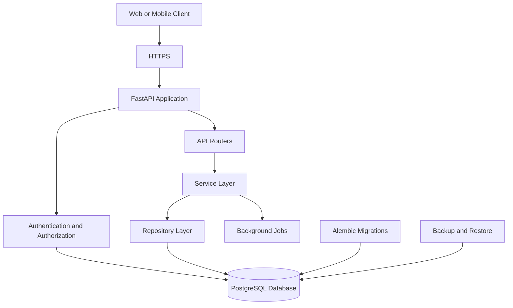

# Capstone Design — Task & Project Management API

## 1. Project Overview

A production-oriented REST API for managing users, projects, and tasks.

## 2. Core Requirements

- User authentication and authorization
- Project creation and management
- Task assignment and status tracking
- Role-based access control
- PostgreSQL persistence
- API validation and error handling
- Automated testing
- HTTPS deployment

## 3. Database Schema

### Database
PostgreSQL 18

### Table 1: users

Stores registered users and authentication details.

| Column | Type | Constraints |
|---|---|---|
| id | UUID | Primary key |
| full_name | VARCHAR(150) | NOT NULL |
| email | VARCHAR(255) | UNIQUE, NOT NULL |
| password_hash | TEXT | NOT NULL |
| is_active | BOOLEAN | DEFAULT TRUE |
| created_at | TIMESTAMPTZ | NOT NULL |

### Table 2: projects

Stores projects created by users.

| Column | Type | Constraints |
|---|---|---|
| id | UUID | Primary key |
| name | VARCHAR(200) | NOT NULL |
| description | TEXT | Nullable |
| owner_id | UUID | Foreign key → users.id |
| created_at | TIMESTAMPTZ | NOT NULL |

### Table 3: project_members

Stores project membership and permissions.

| Column | Type | Constraints |
|---|---|---|
| project_id | UUID | Foreign key → projects.id |
| user_id | UUID | Foreign key → users.id |
| role | VARCHAR(20) | NOT NULL |
| joined_at | TIMESTAMPTZ | NOT NULL |

Primary key: (project_id, user_id)

Allowed roles: owner, admin, member.

### Table 4: tasks

Stores tasks associated with projects.

| Column | Type | Constraints |
|---|---|---|
| id | UUID | Primary key |
| project_id | UUID | Foreign key → projects.id |
| title | VARCHAR(200) | NOT NULL |
| description | TEXT | Nullable |
| status | VARCHAR(20) | NOT NULL |
| priority | VARCHAR(20) | NOT NULL |
| assigned_to | UUID | Nullable foreign key → users.id |
| created_by | UUID | Foreign key → users.id |
| due_date | DATE | Nullable |
| created_at | TIMESTAMPTZ | NOT NULL |
| updated_at | TIMESTAMPTZ | NOT NULL |

Allowed statuses: todo, in_progress, done.

Allowed priorities: low, medium, high.

### Relationships

- One user can own multiple projects.
- One project can have multiple members.
- One user can belong to multiple projects.
- One project can contain multiple tasks.
- One user can be assigned multiple tasks.
- Every task belongs to exactly one project.

### Integrity and Indexing

- Enforce foreign keys at the database level.
- Index tasks(project_id, status).
- Index tasks(assigned_to).
- Index projects(owner_id).
- Enforce unique user emails.
- Enforce valid task statuses, priorities, and member roles.
- Ensure task assignees belong to the associated project.
- Maintain project ownership consistently with project membership.

### Schema Management

Use SQLAlchemy ORM models and Alembic migrations.

All schema changes must be version-controlled.


## 4. API Specification

### API Overview

- Framework: FastAPI
- Architecture: REST
- Base path: `/api/v1`
- Data format: JSON
- Authentication: JWT Bearer tokens
- Database: PostgreSQL
- API documentation: OpenAPI / Swagger UI

### 4.1 Authentication APIs

| Method | Endpoint | Description | Success |
|---|---|---|---|
| POST | /auth/register | Register a new user | 201 |
| POST | /auth/login | Authenticate and receive JWT | 200 |
| GET | /users/me | Get current user profile | 200 |

Registration requires full_name, email, and password.

Login requires email and password.

Passwords must be securely hashed and never returned in responses.

### 4.2 Project APIs

| Method | Endpoint | Description | Success |
|---|---|---|---|
| POST | /projects | Create a project | 201 |
| GET | /projects | List accessible projects | 200 |
| GET | /projects/{project_id} | Retrieve a project | 200 |
| PATCH | /projects/{project_id} | Update a project | 200 |
| DELETE | /projects/{project_id} | Delete a project | 204 |

### 4.3 Project Membership APIs

| Method | Endpoint | Description | Success |
|---|---|---|---|
| POST | /projects/{project_id}/members | Add a member | 201 |
| GET | /projects/{project_id}/members | List members | 200 |
| PATCH | /projects/{project_id}/members/{user_id} | Change member role | 200 |
| DELETE | /projects/{project_id}/members/{user_id} | Remove a member | 204 |

### 4.4 Task APIs

| Method | Endpoint | Description | Success |
|---|---|---|---|
| POST | /projects/{project_id}/tasks | Create a task | 201 |
| GET | /projects/{project_id}/tasks | List project tasks | 200 |
| GET | /projects/{project_id}/tasks/{task_id} | Retrieve a task | 200 |
| PATCH | /projects/{project_id}/tasks/{task_id} | Update a task | 200 |
| DELETE | /projects/{project_id}/tasks/{task_id} | Delete a task | 204 |

Task listing supports pagination and filtering by status, priority, and assignee.

### 4.5 Example: Create Task

Request:

POST /api/v1/projects/{project_id}/tasks

Authorization: Bearer JWT

```json
{
  "title": "Implement authentication",
  "description": "Develop JWT login functionality",
  "status": "todo",
  "priority": "high",
  "assigned_to": null,
  "due_date": "2026-12-01"
}
```

Successful response: HTTP 201 Created

```json
{
  "id": "550e8400-e29b-41d4-a716-446655440000",
  "project_id": "550e8400-e29b-41d4-a716-446655440001",
  "title": "Implement authentication",
  "status": "todo",
  "priority": "high",
  "assigned_to": null,
  "due_date": "2026-12-01"
}
```

### 4.6 Authorization Rules

- All project and task endpoints require authentication.
- Project owners can manage projects and membership.
- Admins can manage project tasks and membership, except ownership.
- Members can view projects and create or update permitted tasks.
- Only authorized users can access project resources.
- Task assignees must be members of the corresponding project.
- Authorization must be checked on every resource request.

### 4.7 Standard HTTP Responses

| Status | Meaning |
|---|---|
| 200 | Successful request |
| 201 | Resource created |
| 204 | Successful deletion |
| 400 | Invalid business operation |
| 401 | Missing or invalid authentication |
| 403 | Insufficient permissions |
| 404 | Resource not found |
| 409 | Duplicate or conflicting resource |
| 422 | Request validation failed |
| 500 | Unexpected server error |

### 4.8 API Security

- Use HTTPS in production.
- Validate inputs with Pydantic.
- Store password hashes, never plaintext passwords.
- Keep JWT signing keys in environment variables.
- Use short-lived access tokens.
- Enforce role-based authorization.
- Apply rate limiting to authentication endpoints.
- Avoid exposing secrets in API responses or logs.
- Use parameterized database operations through SQLAlchemy.

### 4.9 Testing Strategy

- Unit tests for validation and business logic.
- Integration tests for PostgreSQL operations.
- Authentication and authorization tests.
- API response and error-handling tests.
- Migration tests.
- Automated test execution with pytest.


## 5. System Architecture

### Architecture Overview

The capstone follows a layered backend architecture.



### Architecture Components

| Component | Responsibility |
|---|---|
| Client | Sends HTTP requests and displays responses |
| HTTPS | Encrypts communication |
| FastAPI | Handles requests, validation, and responses |
| Authentication | Verifies JWT tokens and user identity |
| Authorization | Enforces project-level permissions |
| API Routers | Organizes authentication, project, member, and task endpoints |
| Service Layer | Implements business rules |
| Repository Layer | Encapsulates database queries |
| PostgreSQL | Stores users, projects, memberships, and tasks |
| Alembic | Manages version-controlled database migrations |
| Background Jobs | Handles optional asynchronous operations |
| Backup and Restore | Supports database recovery |

### Request Flow

1. Client sends an HTTPS request.
2. FastAPI validates the request.
3. Authentication verifies the user's identity.
4. Authorization checks resource permissions.
5. Service layer executes business logic.
6. Repository layer accesses PostgreSQL.
7. FastAPI returns a JSON response.

### Deployment Architecture

- FastAPI application hosted on Render.
- PostgreSQL hosted on Render.
- Environment variables store configuration and secrets.
- Alembic manages database migrations.
- HTTPS protects public API traffic.
- External backups support database recovery.
- GitHub stores application code and deployment configuration.

### Design Principles

- Separation of concerns
- Dependency injection
- Secure configuration management
- Database transaction management
- RESTful API conventions
- Automated testing
- Maintainable project structure


## 6. Security and Deployment

### 6.1 Security Architecture

The capstone follows secure backend development practices.

- HTTPS is required for all production API traffic.
- JWT access tokens authenticate users.
- Role-based access control protects project resources.
- Passwords are hashed using a modern password-hashing algorithm such as Argon2id.
- Database credentials and signing keys are stored in environment variables.
- Pydantic validates incoming requests.
- SQLAlchemy uses parameterized queries.
- Authentication endpoints use rate limiting.
- API responses and logs must not expose secrets.
- Database access follows the principle of least privilege.

### 6.2 Deployment Strategy

| Component | Technology |
|---|---|
| Source control | Git and GitHub |
| Backend | Python 3.12 and FastAPI |
| Application server | Uvicorn |
| Database | PostgreSQL |
| Database migrations | Alembic |
| Hosting | Render |
| HTTPS | Render-managed TLS |
| Configuration | Environment variables |
| Testing | pytest |
| Dependency management | uv |

### 6.3 Deployment Workflow

1. Develop and test changes locally.
2. Run automated tests.
3. Commit reviewed changes to GitHub.
4. Deploy the application to Render.
5. Configure production environment variables.
6. Apply database migrations.
7. Start the FastAPI application.
8. Verify health checks and API endpoints.
9. Monitor application logs.

For a production deployment with multiple application instances, database migrations should run as a separate, coordinated deployment step rather than independently in every application process.

### 6.4 Database Backup and Recovery

- Create regular PostgreSQL backups using pg_dump.
- Store backup files securely outside the source repository.
- Encrypt backups when storing or transferring them.
- Define backup retention and access policies.
- Periodically test restoration into an isolated database.
- Verify restored tables, constraints, and records.
- Document recovery procedures and compatibility limitations.

The Day 28 deployment demonstrated a successful backup and recovery test.

The Render PostgreSQL 18.7 backup required removal of unsupported pg_attver metadata statements from a separate SQL copy before restoration into local PostgreSQL 18.6.

The original backup archive remained unchanged.

### 6.5 Operational Considerations

- Configure application health checks.
- Monitor errors and deployment logs.
- Use least-privilege database credentials.
- Avoid storing secrets in Git.
- Maintain database migration history.
- Test application recovery procedures.
- Review dependency updates.
- Document deployment and rollback procedures.

### 6.6 Current Scope

This document describes the proposed capstone architecture.

The complete Task & Project Management API has not yet been implemented.

The Day 28 Render Deployment API is a separate, smaller application used to demonstrate:

- HTTPS deployment
- PostgreSQL connectivity
- Alembic migrations
- Environment-based configuration
- API testing
- Database backup and recovery
